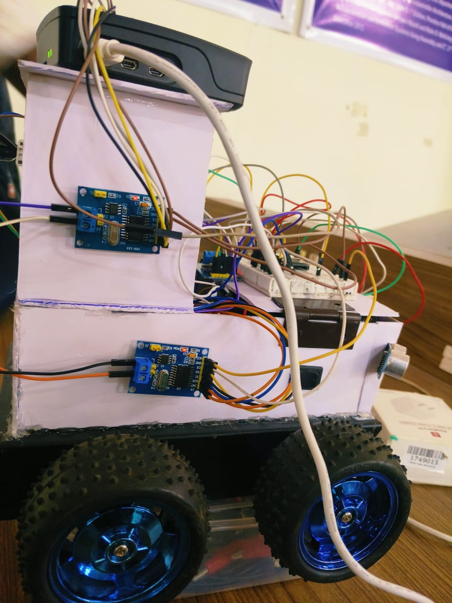
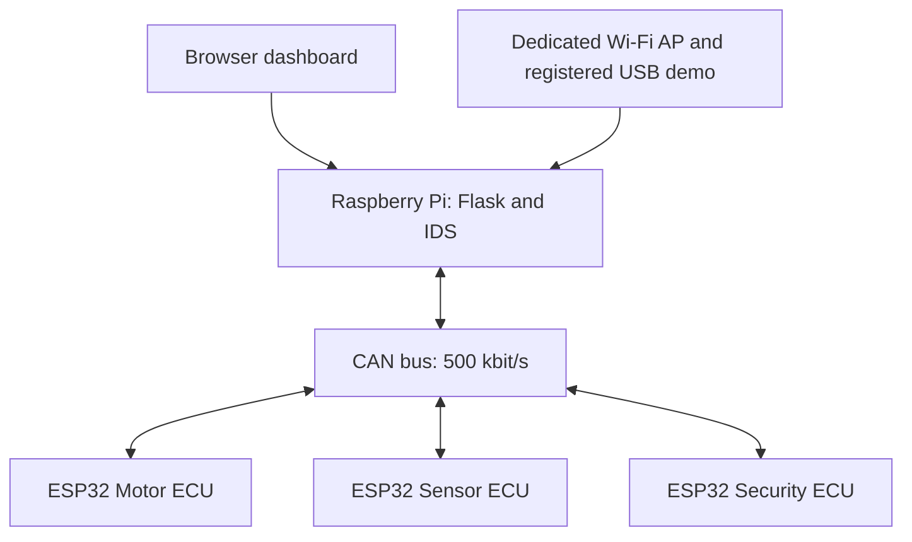
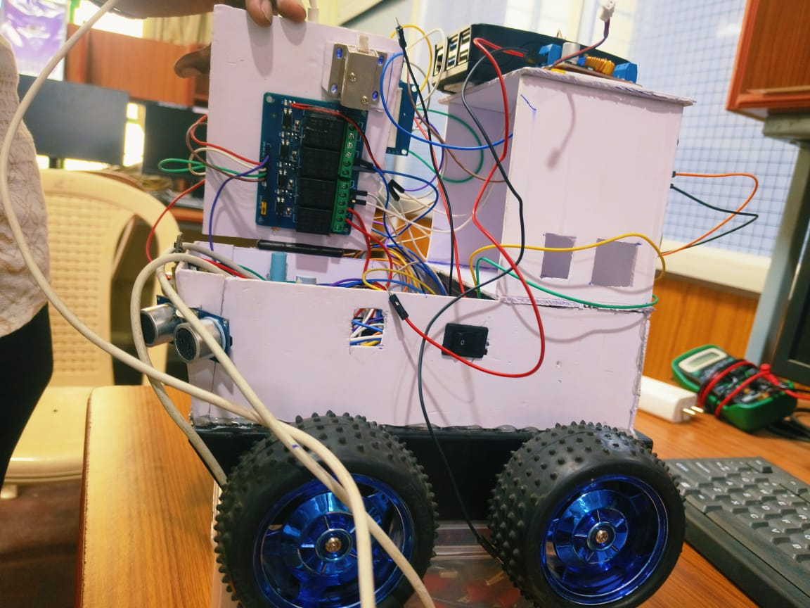

# CAN IDS — Raspberry Pi + ESP32 laboratory testbed

A Raspberry Pi gateway controls three ESP32 ECUs over CAN at 500 kbit/s. Its Flask dashboard shows heartbeats, distance sensors, motor/lock state and the IDS countdown. Use Windows Terminal, PuTTY, Raspberry Pi Connect or VS Code to work on the same Pi checkout.



**Start here:** [Connect to the Pi](#1-connect-to-the-pi) · [Install](#2-install-on-the-pi) · [Wi-Fi](#3-configure-wi-fi-from-env) · [CAN](#4-bring-up-can) · [Dashboard](#5-use-the-web-interface) · [VS Code → Pi runner](#6-edit-locally-in-vs-code-and-sync-directly-to-the-pi) · [Troubleshooting](#troubleshooting)

## What the current code implements

| Component | Current behavior |
|---|---|
| Live gateway | Root `app.py`; Flask dashboard, SocketCAN RX/TX, node tracking and control |
| Rule mode (ML off) | Detects the **configured demo client**, or a registered USB demo whose configured destination responds to a ping |
| ML mode (toggle on) | Isolation Forest replaces the rule trigger; eight features over a two-second CAN window |
| State machine | `NORMAL → COUNTDOWN → BLOCKED`; condition must clear for the rearm cooldown |
| Network containment | HTTP 403 on the blocked client's joystick, solenoid and ML-toggle requests; monitoring and SSH stay reachable |
| CAN containment | Stops the motor and refuses all control/ML-toggle requests while contained; it does not filter CAN frames on the wire |
| Control loss | Pi stops stale joystick commands after `JOYSTICK_TIMEOUT`; Motor ECU also has a 500 ms CAN-command timeout |
| Offline code | Experimental `ids/` training/evaluation utilities, including Random Forest; feature arithmetic delegates to `can_features.py`, but its bundles/policy engine are not used by the live gateway |

This is a lab demonstration, with no measured accuracy or inference-latency claim. MQTT, key rotation and rolling-counter authentication are not implemented. A known client's presence is a demonstration trigger, not a general classifier of malicious Wi-Fi activity. The dashboard has no user login; keep it on the trusted test network.

### Access and server model

The joystick, solenoid and ML toggle are unauthenticated. Any reachable client can control the testbed before containment; an IP-based block is not user authentication. The default `APP_HOST=0.0.0.0` listens on every IPv4 interface, including management Wi-Fi, not just the Vehicle-IDS AP. Use an isolated lab network and an appropriate bind address; do not publish the port or forward it from the internet. `APP_HOST=127.0.0.1` with the documented SSH tunnel restricts dashboard access to the Pi/tunnel. There is no general origin policy or CSRF token; JSON content-type checks do not replace authentication.

The default Flask development server is for this lab demonstration. For the optional threaded Waitress server, install `.venv/bin/python -m pip install -r requirements-server.txt`, set `APP_SERVER=waitress` in `.env`, and start with the existing runner/service (`python app.py`). This keeps the CAN/IDS worker threads in the same process as the web server. Do not launch `waitress-serve app:app` or a multi-worker WSGI command: importing `app` alone does not start the controller threads, and multiple controllers compete for CAN/state. See [Waitress usage](https://docs.pylonsproject.org/projects/waitress/en/stable/usage.html).

Ctrl+C, SIGTERM and normal interpreter exit release the CAN bus; cleanup and sends share a lock. Power loss/SIGKILL cannot run cleanup, so the motor ECU's independent command timeout remains necessary.



## 1. Connect to the Pi

In Raspberry Pi Imager, set a username, hostname such as `vehicle-pi`, home Wi-Fi credentials and country, and enable SSH. `piuser` below means **the username you created**, not a required/default account. Keep the Pi on home Wi-Fi (`wlan0`) or Ethernet for development; reserve a second Wi-Fi adapter (`wlan1`) for the lab AP.

### Windows CMD, PowerShell or Windows Terminal

```powershell
ssh piuser@vehicle-pi.local
```

If `.local` does not resolve, use the Pi IPv4 from your router's client list, e.g. `ssh piuser@192.168.1.50`. Verify the SSH host fingerprint when first connecting. If SSH was not enabled, use a Pi-local terminal to run `sudo systemctl enable --now ssh`.

For dashboard access through an SSH tunnel, leave this Windows terminal open:

```powershell
ssh -L 5000:127.0.0.1:5000 piuser@vehicle-pi.local
```

Open <http://localhost:5000> on Windows. Change both port numbers if `APP_PORT` changes.

### PuTTY

1. Set **Host Name** to `vehicle-pi.local` or the Pi IPv4, **Port** to `22`, **Connection type** to SSH.
2. Optionally save the session as `Vehicle Pi`. Open it and log in as your Pi user.
3. Run the same Linux commands below. For a tunnel, before opening the session go to **Connection → SSH → Tunnels**, source port `5000`, destination `127.0.0.1:5000`, choose **Local**, then **Add**.

### Raspberry Pi Connect (browser terminal)

On the Pi, check `rpi-connect --version`. If absent, install the matching package: `sudo apt install rpi-connect-lite` on Raspberry Pi OS Lite (remote shell), or `sudo apt install rpi-connect` on Desktop (shell and supported screen sharing). Then run as the normal Pi user:

```bash
rpi-connect on
rpi-connect signin
rpi-connect status
```

Follow the sign-in link, visit <https://connect.raspberrypi.com>, choose the Pi and **Remote shell**. Use the installation, Git and service commands below in that shell. For a headless Pi that must remain available after logout: `sudo loginctl enable-linger "$USER"`.

Connect remote shell does **not** publish the Flask dashboard to your Windows browser. Access it on your LAN, through a reachable SSH/VPN tunnel, or open the Pi's own browser through Connect screen sharing on a supported desktop. Check state from Connect shell with `curl http://127.0.0.1:5000/api/state`.

## 2. Install on the Pi

Commands in `bash` blocks run **on the Pi**, including SSH, PuTTY or Connect shell. Use Raspberry Pi OS Bookworm or later; Python 3.11+ is the intended baseline.

```bash
sudo apt update
sudo apt install -y git python3-venv python3-pip can-utils iproute2 iw network-manager
git clone https://github.com/Muthuram30/Can_ids.git ~/Can_ids
cd ~/Can_ids
bash scripts/setup.sh
nano .env
```

Set real Wi-Fi credentials and the designated demo-client address in `.env`. Values containing spaces or `#` must be quoted, e.g. `HOME_PASSWORD="a space # password"`. The Python entry points load this file directly; exported environment variables take precedence. Do not run `source .env` or `export $(cat .env | xargs)`.

```bash
bash scripts/runner.sh
```

The dashboard starts even with no CAN adapter, AP or model present. It reports those as unavailable; this does not demonstrate hardware operation. Press Ctrl+C to stop. Installation uses `.venv`, without `--break-system-packages` or changes to global Python dependencies.

## 3. Configure Wi-Fi from .env

**Home Wi-Fi:** normally set this in Imager. To change it later, set `HOME_IFACE`, `HOME_SSID` and `HOME_PASSWORD` in `.env`, then run the following from a local terminal or Ethernet session; changing the interface carrying SSH can disconnect that session.

```bash
cd ~/Can_ids
sudo raspi-config nonint do_wifi_country IN
sudo .venv/bin/python scripts/setup_wifi.py home
```

Use your actual country instead of `IN` outside India. `WIFI_COUNTRY` in `.env` is a reminder; `raspi-config` sets the OS regulatory country.

**Lab AP:** plug in an AP-capable second Wi-Fi adapter. Confirm its name using `nmcli device status` and AP capability using `iw list`; interface names may differ from `wlan1`. Set `AP_IFACE` accordingly, keep it different from `HOME_IFACE`, and set `AP_SSID`, a real `AP_PASSWORD`, and `AP_IP=10.50.0.1`.

```bash
iw list
.venv/bin/python scripts/setup_wifi.py status
sudo .venv/bin/python scripts/setup_wifi.py ap
```

The helper creates only the `vehicle-ids-ap` NetworkManager profile, with WPA2, DHCP/shared networking, a `/24` address and automatic reconnect. It does not reconfigure the management adapter. Leave `AUTO_FIX_AP=0`; the old hostapd repair mode must not compete with NetworkManager. If migrating an existing hostapd/dnsmasq lab AP, see [the network guide](docs/network-and-remote-access.md#existing-hostapddnsmasq-setups) before enabling the new one.

Join `Vehicle-IDS-AP` on the demo laptop. In **Windows**, run `ipconfig` and copy that adapter's IPv4 (not the home-Wi-Fi address) into `ATTACKER_IP` in the **Pi's `.env`**. Restart the app. DHCP may assign an address other than `.100`; do not assume that default is correct. Optional `ATTACKER_MAC` tracks the chosen client if its IPv4 changes; use the MAC reported for this AP, accounting for Windows randomized addresses.

Open <http://10.50.0.1:5000> from the AP client. To stop only this project's hotspot:

```bash
sudo .venv/bin/python scripts/setup_wifi.py down
```

## 4. Bring up CAN

Hardware: Raspberry Pi, three ESP32 boards, a CAN controller/transceiver at each node, appropriate motor/lock drivers, sensors, common ground and two 120 Ω terminators (one at each bus end). All firmware uses 500 kbit/s. Check each board's actual oscillator; the Pi controller's crystal is independent of an ESP32 module's crystal.

For the Pi SPI0 MCP2515 connection:

| Signal | Pi physical pin | BCM GPIO |
|---|---:|---:|
| MOSI | 19 | 10 |
| MISO | 21 | 9 |
| SCLK | 23 | 11 |
| CE0/CS | 24 | 8 |
| INT | 22 | 25 |
| Ground | 6 | GND |

Use a Pi-compatible 3.3 V logic interface. Common 5 V MCP2515/TJA1050 boards may need separate supplies or level shifting; do not assume their VCC or MISO is Pi-safe. Power motors/solenoid through their drivers, not Pi GPIO.

Edit `/boot/firmware/config.txt` (or the boot configuration path for your OS). For a **verified 8 MHz Pi-side module** with INT on GPIO25:

```ini
dtparam=spi=on
dtoverlay=mcp2515-can0,oscillator=8000000,interrupt=25
```

Reboot, then:

```bash
cd ~/Can_ids
bash can/can0_setup.sh can0 500000
ip -details -statistics link show can0
candump can0
```

Stop `candump` with Ctrl+C. Use the matching channel in `.env`. Bring CAN up again after reboot unless you have configured an OS CAN service. Flash each sketch under `esp32/` separately with Arduino IDE and its required libraries. Each sketch must live in its own same-named Arduino sketch folder. ESP32 pin definitions and sensor libraries are in those files; a Git pull on the Pi **does not flash ESP32 firmware**.

See [CAN ID map and firmware notes](docs/hardware-and-can.md).

## 5. Use the web interface

1. Start the app, then open `http://PI_LAN_IP:5000` on the home network, `http://10.50.0.1:5000` on the lab AP, or `http://localhost:5000` through the SSH tunnel.
2. Check motor/sensor/security node dots and distances. Missing heartbeats go offline after two seconds. Check `can_up` in `/api/state` if hardware is absent.
3. Drag and **hold** the joystick to move; release, cancel, switch away or lose the browser connection to stop. Movement requests are coalesced at up to 20 Hz, with a held-position refresh every 200 ms. STOP bypasses the throttle and follows any in-flight request; a stalled request is covered by the Pi/ECU timeouts. Test with wheels raised first.
4. Use lock ON/OFF for the security ECU. The response confirms the request, not physical actuation; verify the returned lock status.
5. Keep **ML off** for the Wi-Fi/USB demo. The designated AP client's presence starts the countdown; controls from that client return HTTP 403 after the delay. Disconnect it and wait `REARM_COOLDOWN` seconds for rearm.
6. For the CAN ML demo, first generate the compatible model, then enable the ML toggle. While enabled, CAN anomaly scoring replaces the Wi-Fi/USB trigger. A sustained anomaly leads to motor stop and global control refusal until the condition clears and rearm completes.

```bash
cd ~/Can_ids
.venv/bin/python train_can_ids_model.py
```

The trainer creates a **synthetic baseline** model at `can_ids_model.joblib` (ignored by Git). It is a smoke-test model, not a validated detector for your physical traffic. Keep the live model path consistent with `ML_MODEL_PATH`; changing hardware traffic requires proper data collection and validation. Never load an untrusted joblib file.

The optional USB demonstration needs explicit registration and installation: [USB guide](docs/usb-demo.md). It executes a fixed repository script, never files from the inserted drive.

## 6. Edit locally in VS Code and sync directly to the Pi

Two Windows runners handle the lab workflow:

| Runner | Purpose |
|---|---|
| `run_pi.cmd` | First-time connection/folder setup, then source commits and synchronization |
| `run.cmd` | Menu for running the app, opening a Pi terminal, tests, configuration and service control |

On first use, `run_pi.cmd` asks for the SSH login and target, checks the laptop's tools, connects to the Pi with a terminal, installs missing Python/venv/Git/SSH-client/editor prerequisites via apt/sudo when necessary, and creates/verifies the chosen folder **before making source commits**. Your SSH user may need to enter a sudo password during setup. Later runs reuse the saved settings. Use a reachable Pi hostname/IP over Wi-Fi, Ethernet, hotspot or VPN; VS Code, CMD, PowerShell and PuTTY can all use that SSH connection. Raspberry Pi Connect remote shell alone does not create a network route for Windows SSH.


Open this checkout in VS Code. In its Windows integrated terminal run:

```powershell
.\run_pi.cmd
```

The first run asks for your SSH login and destination, for example `muthu@vehicle-pi.local` and `~/can_ids`. It remembers them locally, so the same command works afterwards. A Git clone or downloaded/extracted repository ZIP works: if needed, the runner initializes local Git after the Pi setup check. Or supply them explicitly:

```powershell
.\run_pi.cmd --host muthu@vehicle-pi.local --target /home/muthu/can_ids
```

Use `~/can_ids`, `/home/can_ids`, `/home/muthu/can_ids`, `/muthu/can_ids` or another writable absolute path ending in `can_ids`. The app, virtual environment, local configuration, sync manifest and backups all live under that chosen project folder. Scripts discover their own location; there is no required Pi username. If you choose `/home/can_ids`, its parent permissions may require the one-time ownership setup described in the [sync guide](docs/pi-sync.md).

The runner transfers saved local files over SSH without requiring a GitHub commit/push, rsync, WSL or a Python package on Windows. It adds new source files, replaces edited files, deletes previously synchronized files that you deleted locally, and handles renames as removal plus addition. Before replacing/removing existing source it keeps a timestamped copy inside the Pi folder. `.env`, `.venv`, models, captured data, runtime state, logs, Git metadata and saved connection settings are protected.

To update automatically as you save/add/delete files in VS Code:

```powershell
.\run_pi.cmd --watch
```

Press Ctrl+C to stop. Watch mode uses SSH key/agent authentication for subsequent transfers; see the guide for setup. Unsaved editor text is not transferred. Git-ignored files are omitted, including generated build outputs.

If the chosen Pi folder already contains an older project and has no sync manifest, explicitly adopt it once:

```powershell
.\run_pi.cmd --adopt
```

This backs up and removes obsolete non-runtime source files in that **chosen folder** to match the local snapshot. Later runs automatically reconcile the recorded source files. Files created independently on the Pi after adoption are left alone unless they conflict with a source path. Use the Windows checkout as the source of truth for synchronized files.

By default, the runner commits changed source locally, sends it to the Pi, creates the Pi virtual environment if absent, installs dependencies initially/when requirements change, runs tests, and restarts an already running `vehicle-ids.service` after successful checks. It regenerates the service unit with your chosen folder before restarting. After successful preparation/checks it also creates a source checkpoint in the Pi folder, recording the laptop commit. No-change runs reuse the existing commit. Secrets and runtime files are excluded from both histories. The first run creates `.env` from the example only if it does not already exist: edit real Wi-Fi/client settings there once. It does not flash ESP32 boards or configure Wi-Fi/CAN implicitly.

Useful variants:

```powershell
.\run_pi.cmd --setup
.\run_pi.cmd --code-only
.\run_pi.cmd --no-restart
```

`--setup` changes the saved connection; `--no-commit` disables source checkpoints; `--message "Lab update"` supplies their message; `--code-only` skips dependency/test/service steps; `--no-restart` runs setup/checks while leaving the current service running. The optional PowerShell wrapper supports the same workflow: `.\scripts\deploy.ps1 -PiHost muthu@vehicle-pi.local -Target ~/can_ids -Watch`.

Run app/terminal commands from the laptop using the same remembered connection:

```powershell
.\run.cmd
.\run.cmd app
.\run.cmd terminal
.\run.cmd start
.\run.cmd logs
.\run.cmd test
.\run.cmd config
```

The menu offers those actions plus stop/restart/status/train. `app` runs in the foreground; if the app already runs as a service it shows the service logs instead of starting a duplicate controller. `start` installs/starts the user service at the chosen path. `config` edits the Pi's `.env`. `terminal` opens an interactive Pi shell in that folder. Ctrl+C stops a foreground session; a user service continues independently.

For boot without a login, enable lingering once in the Pi terminal as described in section 7. Existing instructions using `~/Can_ids` refer to a normal Git clone; replace that directory with your chosen sync destination. See [all sync options, recovery and GitHub push steps](docs/pi-sync.md).

**GitHub publication is separate:** after reviewing and committing local changes, `git push origin main` publishes them. The sync runner creates source commits by default, but never pushes to GitHub automatically or requires you to stage edits manually. Publish from the laptop after a successful sync with `git push origin main`; Pi commits form a separate local deployment history. `scripts/update.sh` remains an optional Git-pull workflow for a separate Git-managed Pi checkout; use one deployment method per folder.

## 7. Run automatically after boot

Stop any foreground app first; two instances would compete for port 5000 and send duplicate CAN traffic.

```bash
cd ~/can_ids  # or your chosen target folder
bash scripts/install_service.sh
sudo loginctl enable-linger "$USER"
systemctl --user status vehicle-ids.service
journalctl --user -u vehicle-ids.service -f
```

This generates a service with your actual checkout path and user. It runs Flask as that user and loads `.env` through Python. It does not start a root web server or alter your network on each boot. CAN must be configured separately. After a `.env` edit: `systemctl --user restart vehicle-ids.service`.

## Troubleshooting

| Symptom | Check or action |
|---|---|
| `vehicle-pi.local` not found | Use the router-assigned IPv4; ensure client isolation is disabled on the management LAN |
| SSH connection refused | Enable SSH locally/in Imager; check Pi power, LAN and port 22 |
| Page unavailable | `systemctl --user status vehicle-ids.service`; `ss -ltnp`; correct `APP_PORT`; avoid running two apps |
| `TemplateNotFound` | Run root `app.py`; `templates/dashboard.html` must exist alongside it |
| `.env` appears ignored | Restart; exported variables override `.env`; the runner prints no passwords |
| `can0` missing | Check SPI overlay, actual crystal, INT wiring and reboot; `dmesg` and `ip link` |
| CAN bus-off/no node data | Match 500 kbit/s, common ground, H/L and two terminators; inspect CAN statistics |
| AP helper fails | Verify AP support/driver, actual interface name, country and NetworkManager; avoid legacy daemon conflicts |
| Wi-Fi demo never starts | Set the AP-client IPv4/MAC, restart; inspect `ip neigh show dev wlan1` and `iw dev wlan1 station dump` |
| hostapd/dnsmasq false in JSON | Expected when NetworkManager owns the AP; interface state and client reachability determine operation |
| ML unavailable | Run the root trainer in `.venv`, check `ML_MODEL_PATH`; offline `ids.train` outputs are incompatible |
| PuTTY/SSH closes and app stops | Use the user service; enable lingering for boot/logout operation |
| Git push rejected | Authenticate, fetch and inspect history; resolve divergence without force-pushing |

## Files, evidence and backup

| Path | Purpose |
|---|---|
| `app.py`, `templates/`, `can_features.py`, `project_config.py` | Live controller, dashboard, common feature arithmetic and paths |
| `train_can_ids_model.py` | Compatible synthetic-baseline trainer |
| `esp32/`, `can/` | Firmware and Pi CAN link setup |
| `scripts/` | Installation, networking, service generation, deployment and health checks |
| `usb/` | Optional fixed lab payload and registered-device monitor |
| `ids/`, `data/`, `models/` | Experimental offline training/evaluation; local rate overrides stay separate from the live baseline; bundles remain incompatible with the live loader |
| `tests/` | Hardware-independent Flask, CAN and configuration checks |
| `docs/` | Hardware photos, operating guides, historical comparisons and verification limits |

The original public version is commit [`711fa37`](https://github.com/Muthuram30/Can_ids/commit/711fa37a542bc292c766dbe3a42093cf5a9e6557). A local backup branch `backup/before-pi-integration-20261122` and a Git bundle preserve it. This does not imply that the backup branch was published. Inspect it without overwriting your working copy:

```bash
git show 711fa37:README.md
git switch -c inspect-original 711fa37
git switch main
```

The GitHub tree already contained no ZIP files. The update removes the unused `app/` Flask stub, moves its working dashboard into `templates/`, and replaces obsolete hard-coded setup/service files with generated per-device configuration. No original local project folders or archives need deleting.

**Validation:** [test results and Pi-only checks](docs/verification.md). Historical `implementation-comparison.md` and `reference-comparison.md` are design context, not measured validation of this version.

The [review follow-up](docs/code-review-followup.md) records corrected review claims, fixes and remaining hardware evidence. Developer checks: `python -m pip install -r requirements-dev.txt`, `python -m unittest discover -s tests -v`, `python -m ruff check .` and `node --test tests/dashboard.test.cjs`. Node is needed for developer/CI dashboard tests, not for running the Pi controller.

## Latest software validation — 22 November 2026

**54 Python tests and four dashboard JavaScript tests passed locally.** Python compilation and Git whitespace checks also passed. Tests cover virtual-CAN commands, invalid input, command/containment races, mode changes during scoring, timeout STOP, snapshots, shared features, interrupted model replacement and source synchronization.

Training creates missing output directories and replaces the saved model only after a complete write. A failed save leaves the previous model intact. Restart the gateway after retraining to load the new bundle. Monitor results from an older detection-mode generation are discarded, including an OFF/ON switch during scoring. Boolean joystick coordinates are rejected. The Sensor ECU reports the existing `0xFFFF` unknown-distance value when ToF initialization fails or the reading is invalid.

Fresh package installation remains blocked in this execution environment; tests used existing compatible dependencies and official python-can source. Ruff, optional Waitress runtime, Bash execution and ESP32 compilation remain unverified locally. Hardware accuracy, latency and physical actuation still require the Pi/ESP32 testbed; synthetic trainer results are smoke checks only.

### Publish local changes from Windows

Run in PowerShell after reviewing `git diff`. These commands stop if a Git step fails and never force-push:

```powershell
Set-Location 'D:\My Projects\embed_proj\Can_ids-update-20261122'
git add -A
if ($LASTEXITCODE -ne 0) { throw 'Staging failed' }
git commit -m "Fix CAN IDS concurrency, validation and model persistence"
if ($LASTEXITCODE -ne 0) { throw 'Commit failed; inspect git status' }
git pull --rebase origin main
if ($LASTEXITCODE -ne 0) { throw 'Resolve the rebase before pushing' }
git push origin main
```

Existing ignore rules exclude `.env`, `.venv`, generated models and runtime files. GitHub publication does not update the Pi or flash the ESP32s; use the documented Pi runner and Arduino flashing workflow separately.

## Hardware gallery



More original images: [view 3](docs/images/hardware-setup-3.jpeg), [view 4](docs/images/hardware-setup-4.jpeg), [view 5](docs/images/hardware-setup-5.jpeg).

## Team

Barath Raj B · Hari Prasanth S T · Mathumitha E · **Muthuraman M (repository maintainer)** · Vishal SR.

[Additional project materials](https://drive.google.com/file/d/1OOLmNXR9Jynrfqxy_38ZL4V1NH05aDwa/view) · [License](LICENSE)

Setup references: [Raspberry Pi remote access](https://www.raspberrypi.com/documentation/computers/remote-access.html), [Raspberry Pi Connect](https://www.raspberrypi.com/documentation/services/connect.html), [NetworkManager hotspot](https://www.raspberrypi.com/tutorials/host-a-hotel-wifi-hotspot/), [VS Code Remote SSH](https://code.visualstudio.com/docs/remote/ssh).
