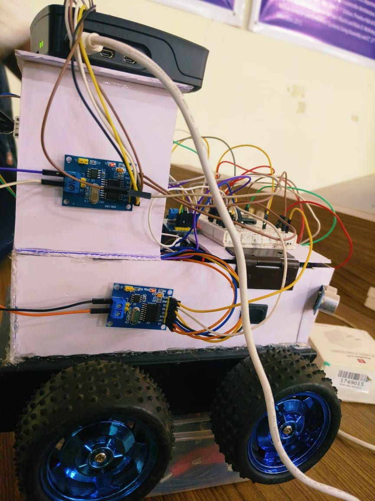
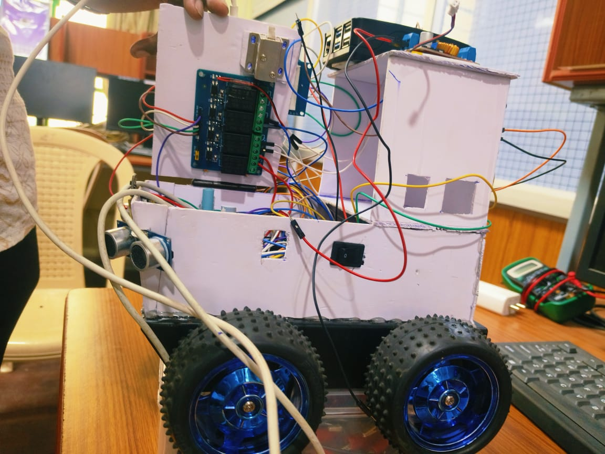
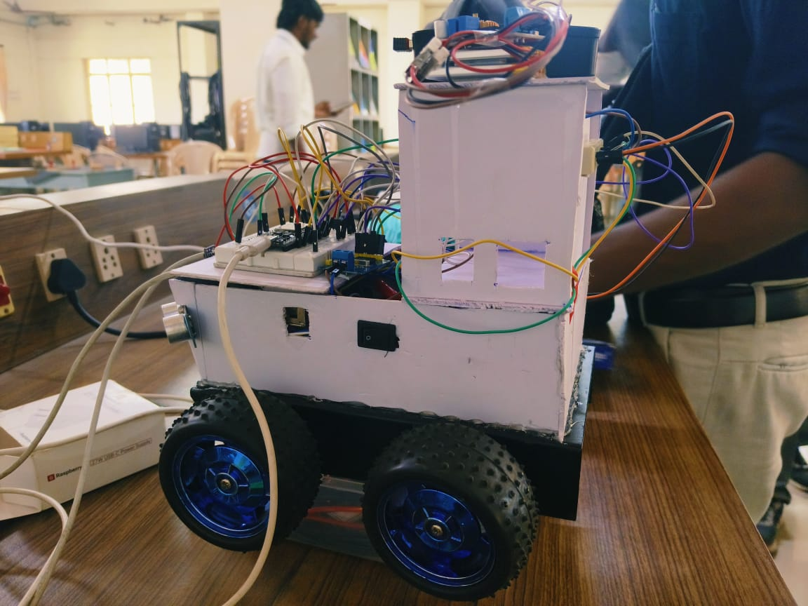
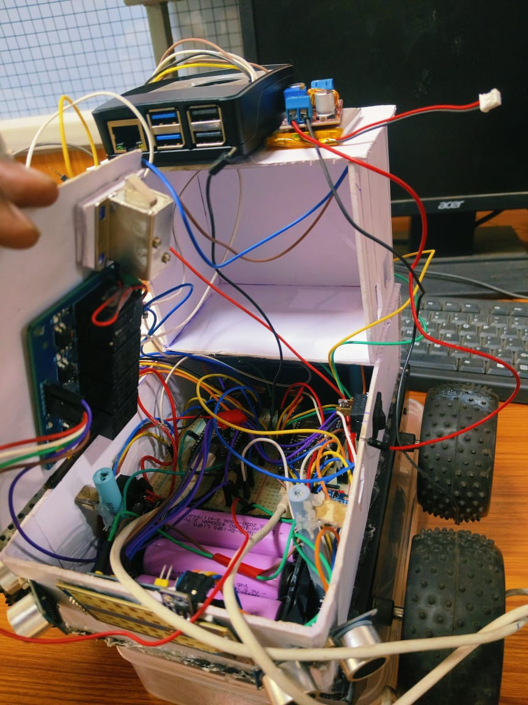
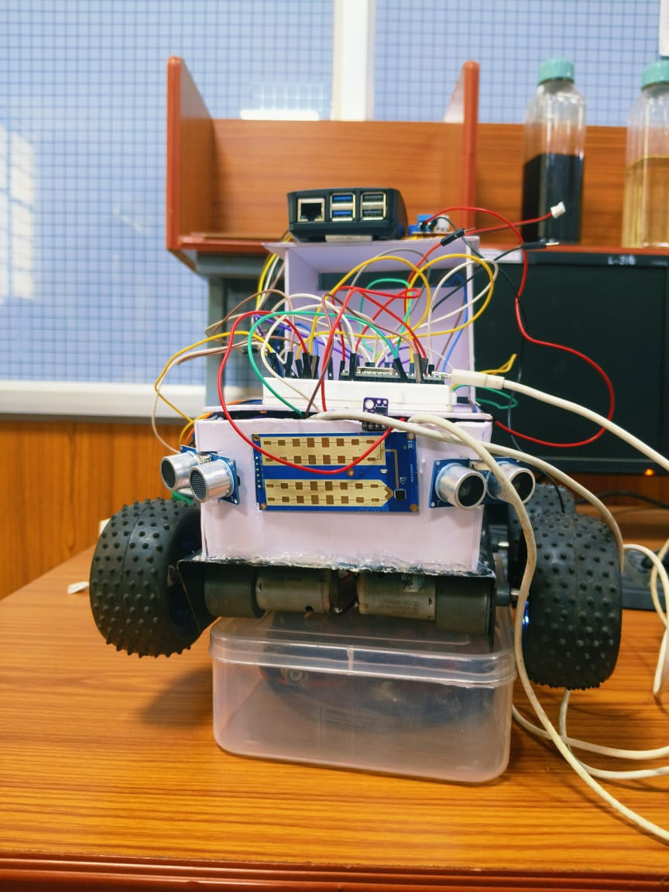

# Microcontroller-Based CAN IDS Integration in Multi-ECU HIL Environment

<p align="center">
  
</p>

<p align="center">
  <strong>A Raspberry Pi 5-based automotive cybersecurity Hardware-in-the-Loop (HIL) project</strong><br>
  <em>Real-time intrusion detection in CAN bus networks using Machine Learning</em>
</p>

<p align="center">
  <a href="#overview">Overview</a> •
  <a href="#architecture">Architecture</a> •
  <a href="#installation">Installation</a> •
  <a href="#usage">Usage</a> •
  <a href="#ml-model-training">ML Training</a> •
  <a href="#documentation">Documentation</a>
</p>

---

## Team

👥 **Project Team**:
- 240371610621011 – **Barath Raj B**
- 240371610621020 – **Hari Prasanth S T**
- 240371610621030 – **Mathumitha E**
- 240371610621035 – **Muthuraman M** (Repository Maintainer)
- 240371610621059 – **Vishal SR**

## Project Resources

<p align="center">
  <a href="https://drive.google.com/file/d/1OOLmNXR9Jynrfqxy_38ZL4V1NH05aDwa/view?usp=sharing">
    
  </a>
  
  
  
</p>

**📁 Resources**:
- 📂 [**Google Drive**](https://drive.google.com/file/d/1OOLmNXR9Jynrfqxy_38ZL4V1NH05aDwa/view?usp=sharing) - Additional materials and demo videos
- 📷 **Hardware Photos** - `docs/images/` (5 setup photos)
- 📄 **Documentation** - Complete guides in `docs/`
- 🎥 **Demo Videos** - Available in project archive

---

## Table of Contents

1. [Overview](#overview)
2. [Architecture](#architecture)
3. [Hardware Requirements](#hardware-requirements)
4. [Software Requirements](#software-requirements)
5. [Installation](#installation)
6. [Configuration](#configuration)
7. [Usage](#usage)
8. [ML Model Training](#ml-model-training)
9. [Attack Demonstration](#attack-demonstration)
10. [Troubleshooting](#troubleshooting)
11. [Project Structure](#project-structure)
12. [Documentation](#documentation)
13. [Safety and Ethics](#safety-and-ethics)

---

## Overview

This project implements a comprehensive **intrusion detection system (IDS)** for automotive CAN networks using machine learning models running on a Raspberry Pi 5. The system demonstrates real-time detection and response to various attack vectors including:

- **CAN bus attacks** (flooding, spoofing, payload anomalies)
- **Network-based attacks** (unauthorized Wi-Fi clients)
- **USB-based attack vectors** (controlled demonstration)

### Key Features

- **Dual ML Models**: Isolation Forest (unsupervised) and Random Forest (supervised)
- **Real-time Detection**: Sub-100ms inference on Raspberry Pi 5
- **Multi-ECU HIL**: Three ESP32-based ECUs (Motor, Sensor, Security)
- **Live Dashboard**: Web-based control and monitoring interface
- **Isolation Mechanism**: Application-layer blocking with safe state enforcement
- **Laboratory-safe**: Controlled demonstrations for educational purposes

---

## Architecture

```
┌─────────────────────────────────────────────────────────────┐
│                    RASPBERRY PI 5 GATEWAY                    │
│                                                               │
│  ┌──────────────┐  ┌──────────────┐  ┌────────────────────┐ │
│  │ Flask Server │  │  IDS Engine  │  │  Security Policy   │ │
│  │  Dashboard   │──│  (ML Models) │──│      Engine        │ │
│  └──────────────┘  └──────────────┘  └────────────────────┘ │
│         │                  │                     │            │
│  ┌──────┴──────┬──────────┴───────┬─────────────┴──────┐    │
│  │   CAN Bus   │   Wi-Fi AP       │   USB Monitor       │    │
│  │  (MCP2515)  │   (wlan1)       │   (udev trigger)    │    │
│  └──────┬──────┴──────────┬───────┴─────────────────────┘    │
└─────────┼─────────────────┼──────────────────────────────────┘
          │                 │
    ┌─────┴────┐      ┌────┴──────┐
    │ CAN Bus  │      │ Attacker  │
    │ (500kbps)│      │ (Network) │
    └────┬─────┘      └───────────┘
         │
   ┌─────┴──────┬──────────┬────────────┐
   │   Motor    │  Sensor  │  Security  │
   │   ECU      │  ECU     │  ECU       │
   │  (ESP32)   │ (ESP32)  │  (ESP32)   │
   └────────────┴──────────┴────────────┘
```

### Detection Flow

```
CAN / Wi-Fi / USB Traffic
        ↓
  Telemetry Collection
        ↓
 Feature Extraction
        ↓
  Preprocessing
        ↓
  ┌─────┴──────┐
  ↓            ↓
Isolation  Random
Forest     Forest
  ↓            ↓
  └─────┬──────┘
        ↓
  Security Policy
        ↓
  ┌─────┴──────┐
  ↓            ↓
ALLOW       ISOLATE
           ↓
      Safe State
           ↓
    Dashboard + Log
```

---

## Hardware Requirements

### Required Components

1. **Raspberry Pi 5** (4GB+ RAM recommended)
   - Power supply (27W USB-C)
   - MicroSD card (32GB+ Class 10)
   - Heat sinks / active cooling

2. **MCP2515 CAN Controller Module** (×1)
   - SPI interface to Raspberry Pi
   - 8MHz crystal oscillator
   - TJA1050 CAN transceiver

3. **ESP32 Development Boards** (×3)
   - Motor ECU
   - Sensor ECU
   - Security ECU

4. **CAN Bus Components**
   - CAN H/L wiring
   - 120Ω termination resistors (×2)

5. **Wi-Fi USB Adapter** (×1)
   - For dedicated Vehicle-IDS AP (wlan1)
   - Must support AP mode
   - Recommended: RT5370/RT3070 chipset

6. **Additional Peripherals**
   - Motor driver board (L298N or similar)
   - DC motors (×4)
   - VL53L0X ToF distance sensor
   - HC-SR04 ultrasonic sensors (×2)
   - Solenoid lock

7. **Development/Testing**
   - Attacker laptop (for demonstration)
   - USB flash drive (for controlled demo)

### Wiring Connections

#### Raspberry Pi → MCP2515 (SPI)
- VCC → 3.3V (Pin 1)
- GND → Ground (Pin 6)
- CS → GPIO 8 (Pin 24)
- SO → GPIO 9/MISO (Pin 21)
- SI → GPIO 10/MOSI (Pin 19)
- SCK → GPIO 11/SCLK (Pin 23)
- INT → GPIO 25 (Pin 22)

#### ESP32 → MCP2515 (Each ECU)
- CS → GPIO 5
- SO → GPIO 19
- SI → GPIO 23
- SCK → GPIO 18
- INT → GPIO 4

*See `docs/wiring.md` for complete wiring diagrams.*

### Hardware Setup Photos

Physical hardware setup images showing the complete HIL testbed:

<p align="center">
  
  
</p>

<p align="center">
  
  
</p>

<p align="center">
  
</p>

**Photos show**:
- ✅ Complete HIL testbed assembly
- ✅ CAN bus wiring and termination
- ✅ ESP32 ECU placement and connections
- ✅ MCP2515 CAN controller integration
- ✅ Raspberry Pi 5 gateway setup with interfaces

---

## Software Requirements

### Operating System
- **Raspberry Pi OS** (64-bit, Bookworm or later)
- Kernel with SocketCAN support (pre-installed on modern Pi OS)

### System Packages
```bash
sudo apt update
sudo apt install -y \\
    python3 python3-pip python3-venv \\
    can-utils \\
    hostapd dnsmasq \\
    git
```

### Python Dependencies
See `requirements.txt`. Key packages:
- Flask (web framework)
- python-can (CAN bus)
- scikit-learn (ML models)
- numpy, pandas (data processing)
- python-dotenv (configuration)

---

## Installation

### 1. Clone/Extract Repository
```bash
cd ~
# If from ZIP:
unzip car-ids-hil-github-ready.zip
cd car-ids-hil

# If from Git:
git clone https://github.com/yourusername/car-ids-hil.git
cd car-ids-hil
```

### 2. Run Setup Script
```bash
chmod +x scripts/setup.sh
sudo ./scripts/setup.sh
```

This script will:
- Install system dependencies
- Create Python virtual environment
- Install Python packages
- Configure CAN interface
- Set up network (dnsmasq, hostapd)
- Install USB demo trigger (if requested)
- Copy example configuration

### 3. Configure Environment
```bash
cp .env.example .env
nano .env
```

**Critical settings to update:**
```bash
# Wi-Fi AP
AP_SSID=Vehicle-IDS-AP
AP_PASSWORD=your_secure_password

# Attacker configuration (for demo)
ATTACKER_IP=10.50.0.100
ATTACKER_MAC=aa:bb:cc:dd:ee:ff  # Optional

# USB device (for demo)
USB_VENDOR_ID=0781  # Your USB stick
USB_PRODUCT_ID=5581
USB_SERIAL=123456789

# ML model
IDS_MODEL=isolation_forest
ML_ENABLED=false
```

### 4. Configure Raspberry Pi Boot
Edit `/boot/firmware/config.txt` (or `/boot/config.txt` on older systems):
```bash
sudo nano /boot/firmware/config.txt
```

Add:
```
dtparam=spi=on
dtoverlay=mcp2515-can0,oscillator=8000000,interrupt=25
```

Reboot:
```bash
sudo reboot
```

### 5. Upload ESP32 Firmware
Using Arduino IDE:
1. Install ESP32 board support
2. Install library: `mcp_can` (Seeed Studio)
3. Open `esp32/Motor_ECU_Node.ino`
4. Select board: ESP32 Dev Module
5. Upload to first ESP32
6. Repeat for Sensor and Security ECUs

---

## Configuration

### CAN Bus
Default: **500 kbps**, standard (11-bit) IDs

To change bitrate, edit `.env`:
```bash
CAN_BITRATE=250000  # or 125000, 500000, 1000000
```

### Network / Access Point
The system uses **wlan1** for the dedicated Vehicle-IDS AP, leaving **wlan0** for normal connectivity.

Configuration files:
- `config/dnsmasq.conf`
- `config/hostapd.conf`

Apply changes:
```bash
sudo systemctl restart hostapd dnsmasq
```

### IDS Thresholds
In `.env`:
```bash
# Isolation Forest
ISOLATION_CONTAMINATION=0.02
IDS_THRESHOLD=0.0  # Scores below this = anomaly

# Random Forest
RF_CONFIDENCE_THRESHOLD=0.7

# Response timing
BLOCK_DELAY=18  # Countdown seconds
REARM_COOLDOWN=5
```

---

## Usage

### Normal Startup
```bash
cd ~/car-ids-hil
./scripts/start.sh
```

Access dashboard:
- **From operator network** (wlan0): `http://<pi-wlan0-ip>:5000`
- **From Vehicle-IDS AP**: `http://10.50.0.1:5000`

### Full System Check
```bash
./scripts/check_system.sh
```

Verifies:
- Python environment
- CAN interface (can0)
- Wi-Fi interfaces
- Network services (hostapd, dnsmasq)
- USB trigger service

### Complete Reinitialization
```bash
./scripts/runner.sh
```

Use this when:
- Wi-Fi dongle was reconnected
- CAN interface needs reset
- Services need restart

### Stop Services
```bash
./scripts/stop.sh
```

### Reset to Clean State
```bash
./scripts/reset.sh
```

---

## ML Model Training

The system supports two models:

### Isolation Forest (Unsupervised)
Trained on **normal traffic only**. Detects anomalies without labeled attack data.

```bash
python3 -m ids.train --model isolation_forest --sim-hours 2.0
```

Output:
- `models/isolation_forest.joblib`
- `models/preprocessor.joblib`

### Random Forest (Supervised)
Requires **labeled data** (normal + attacks).

```bash
python3 -m ids.train --model random_forest --data data/labeled_traffic.csv
```

Output:
- `models/random_forest.joblib`
- `models/rf_preprocessor.joblib`

### Model Evaluation
```bash
python3 -m ids.evaluate \\
    --model models/isolation_forest.joblib \\
    --type isolation_forest \\
    --test-data data/test.csv
```

### Switching Models at Runtime
Via dashboard: Toggle "ML Detection" switch

Or edit `.env` and restart:
```bash
IDS_MODEL=random_forest  # or isolation_forest
```

---

## Attack Demonstration

⚠️ **Laboratory Use Only** ⚠️

All attack demonstrations are controlled and contained within the project's own testbed.

### Network Attack (Wi-Fi)
1. **Attacker** connects to Vehicle-IDS AP
2. **IDS** detects unauthorized MAC/IP
3. **System** enters countdown (18s default)
4. **IDS** blocks attacker (HTTP 403 on control endpoints)
5. **Dashboard** shows UNSAFE→SAFE transition

### CAN Attack (Flooding/Spoofing)
Simulated via script or manual injection:
```bash
# Send flood on 0x100
for i in {1..1000}; do
    cansend can0 100#FF00000000000000
done
```

**IDS** detects rate/ID/payload anomaly → Safe state (motors stop)

### USB Attack Vector
1. Insert **registered** USB device (matched by vendor/product/serial)
2. **udev** triggers `usb_attack_trigger.py`
3. **Payload** (`usb_attack_demo.py`) attempts connection to ATTACKER_IP
4. **IDS** detects network activity → Isolation → Payload terminated

---

## Troubleshooting

### CAN Interface Not Found
```bash
# Check dmesg for MCP2515
dmesg | grep -i mcp251x

# Verify SPI enabled
ls /dev/spidev0.0

# Manually bring up
sudo ip link set can0 type can bitrate 500000
sudo ip link set can0 up
```

### Wi-Fi AP Not Broadcasting
```bash
# Check hostapd
sudo systemctl status hostapd
sudo journalctl -u hostapd -n 50

# Test configuration
sudo hostapd -dd /etc/hostapd/hostapd.conf

# Check interface
ip addr show wlan1
```

### IDS Not Detecting
```bash
# Check model files exist
ls -lh models/

# Verify ML toggle state
curl http://localhost:5000/api/state | jq '.security.ml'

# Check logs
tail -f logs/app.log
```

### USB Trigger Not Firing
```bash
# Check udev rule
ls -l /etc/udev/rules.d/99-vehicle-usb-demo.rules

# Test USB identity
udevadm info -a -n /dev/sda | grep -E 'idVendor|idProduct|serial'

# Monitor udev
udevadm monitor
```

*See `docs/troubleshooting.md` for complete guide.*

---

## Project Structure

```
car-ids-hil/
├── README.md                 # This file
├── LICENSE                   # MIT License
├── .env.example              # Configuration template
├── .gitignore
├── requirements.txt          # Python dependencies
├── requirements-dev.txt      # Development dependencies
│
├── app.py                    # Main Flask application (working)
├── train_can_ids_model.py    # Legacy training script
├── can_features.py           # Legacy feature extraction
│
├── app/                      # Modular Flask app (in progress)
│   ├── __init__.py
│   ├── app.py
│   ├── templates/
│   │   └── dashboard.html
│   └── static/
│
├── ids/                      # Intrusion Detection System
│   ├── __init__.py
│   ├── feature_extraction.py
│   ├── preprocessing.py
│   ├── train.py              # Training pipeline
│   ├── evaluate.py           # Model evaluation
│   ├── collect_telemetry.py
│   ├── policy_engine.py      # Security policy
│   └── models/
│       ├── __init__.py
│       ├── base_model.py
│       ├── isolation_forest_model.py
│       ├── random_forest_model.py
│       └── model_factory.py
│
├── can/                      # CAN bus utilities
│   └── can0_setup.sh
│
├── network/                  # Network configuration
│
├── usb/                      # USB attack demo
│   ├── usb_attack_trigger.py
│   └── usb_attack_demo.py
│
├── esp32/                    # ESP32 ECU firmware
│   ├── Motor_ECU_Node.ino
│   ├── Sensor_ECU_Node.ino
│   └── Security_ECU_Node.ino
│
├── config/                   # Configuration templates
│
├── scripts/                  # Management scripts
│   ├── setup.sh              # One-time setup
│   ├── runner.sh             # Complete initialization
│   ├── start.sh              # Start services
│   ├── stop.sh               # Stop services
│   ├── reset.sh              # Reset state
│   └── check_system.sh       # System verification
│
├── systemd/                  # systemd service files
│   ├── vehicle-usb-attack.service
│   └── vehicle-usb-attack-remove.service
│
├── udev/                     # udev rules
│   └── 99-vehicle-usb-demo.rules
│
├── models/                   # Trained ML models (generated)
│   └── README.md
│
├── data/                     # Training/test data
│   ├── normal/
│   ├── attack/
│   ├── processed/
│   └── README.md
│
├── docs/                     # Documentation
│   ├── architecture.md
│   ├── installation.md
│   ├── configuration.md
│   ├── ml-pipeline.md
│   ├── ml-model-comparison.md
│   ├── attack-demo.md
│   ├── troubleshooting.md
│   ├── implementation-comparison.md
│   └── reference-comparison.md
│
├── tests/                    # Unit tests
│   ├── ids/
│   └── can/
│
└── reports/                  # Generated reports
```

---

## Documentation

Detailed documentation available in `docs/`:

- **[architecture.md](docs/architecture.md)** - System architecture and design
- **[installation.md](docs/installation.md)** - Complete installation guide
- **[ml-pipeline.md](docs/ml-pipeline.md)** - ML training and inference
- **[ml-model-comparison.md](docs/ml-model-comparison.md)** - IF vs RF analysis
- **[attack-demo.md](docs/attack-demo.md)** - Attack demonstration procedures
- **[troubleshooting.md](docs/troubleshooting.md)** - Common issues and solutions

---

## Safety and Ethics

### Laboratory Use Only

This project is designed for **controlled educational demonstrations** in a laboratory environment:

- ✅ Demonstrations run on **isolated test network**
- ✅ Attack payloads are **fixed and documented**
- ✅ No real vehicle systems are targeted
- ✅ All actions are **logged and auditable**

### Prohibited Uses

❌ **DO NOT**:
- Deploy on production vehicle networks
- Use attack techniques outside controlled testbed
- Modify payloads for malicious purposes
- Test on networks you don't own
- Bypass safety interlocks

### Responsible Disclosure

Security vulnerabilities discovered should be:
1. Documented in laboratory notes
2. Reported to course instructor
3. Not disclosed publicly without review

---

## License

MIT License - See [LICENSE](LICENSE) file

---

## Acknowledgments

This project was developed as part of a technical hackathon focused on automotive cybersecurity. Special thanks to:

- Faculty advisors and mentors
- Open-source community (scikit-learn, Flask, python-can)
- Reference implementations and research papers

---

## Contact

For questions about this project:
- **Academic inquiries**: Contact team members via institutional email
- **Technical issues**: Open an issue on the project repository
- **Security concerns**: Follow responsible disclosure process

---

**Version**: 1.0.0  
**Last Updated**: 2024  
**Status**: Laboratory Demonstration / Educational Use
